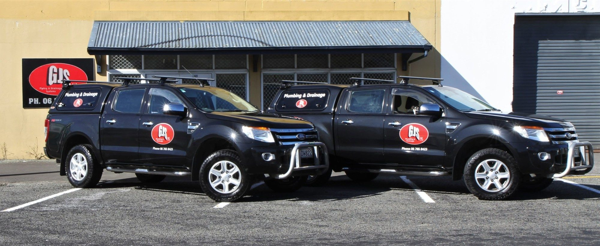
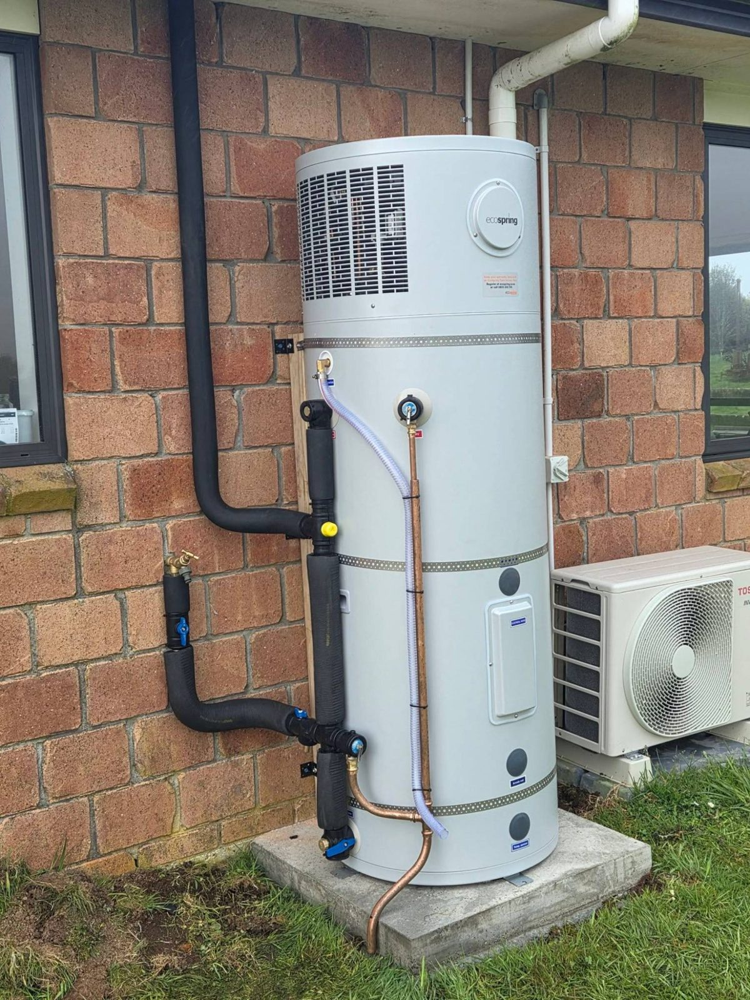

# GJS Plumbing — build partials & component reference

Everything another page needs, taken from the finished home page (`index.html`) and the shared
`styles.css` / `main.js`. **Copy the shared blocks verbatim** — do not edit them per page; active nav
states, the copyright year and the services highlight are all set by `main.js` from the filename.

## Ground rules

- Flat site, relative links only (`plumbing.html`, `assets/…`). Never a leading `/`, never absolute URLs.
- Page skeleton: `HEAD` → `<body>` → **SHARED HEADER** → `<main id="main">…sections…</main>` → **SHARED FOOTER** → `</body></html>`.
- The SHARED HEADER contains the inline SVG icon sprite, so `<use href="#i-…">` works on every page.
- Section rhythm: alternate dark (`.section`) and light (`.section--light`) so a page never reads as one black wall.
  `.section--panel` is a raised dark variant with the pipe pattern. If the last section in `<main>` is dark, the
  CTA band automatically drops its top padding (no double gap).
- Every component reads contextual `--c-*` colour variables, so the same markup works in dark **and** light sections.
- Headings: one `<h1>` per page (in the hero), `<h2>` per section, `<h3>` for cards/items.
- Add `class="reveal"` to section heads/cards for scroll-in animation; stagger siblings with `style="--d:1"`, `--d:2`…
  Content is never hidden without JS.
- Hours (`Mon–Fri 7:30am – 5:00pm`, `24/7 emergency call-outs`) appear only in the shared footer and on contact.html.
- Quote links: `contact.html#quote` (the contact page form card must carry `id="quote"`).
  `contact.html?service=gasfitting#quote` preselects the service dropdown (values: `plumbing`, `drainlaying`,
  `gasfitting`, `hot-water`, `emergency`, `renovations`, `other`).
- Testimonials are sample copy: keep `<!-- SAMPLE TESTIMONIAL: replace with real Google review -->` above each.
- NZ English, no emoji, no invented numbers or years.

### Photos
- Real client photos: `assets/gjs-fleet.jpg` (2000×821, utes at the workshop), `assets/gjs-hot-water-install.jpg`
  (1200×1600 portrait, Ecospring heat-pump install), `assets/gjs-logo-square.jpg` (1200×1200, logo on black).
- Local placeholders (dark, intentional-looking): `assets/ph-plumbing.svg`, `ph-drain.svg`, `ph-gas.svg`,
  `ph-bathroom.svg`, `ph-hotwater.svg` (1600×1000), `ph-map.svg` (1600×900).
- **Every remote (Unsplash) image must carry the fallback**:
```html

```
  The sandbox cannot reach Unsplash, so IDs cannot be verified — the fallbacks are what reviewers will see.
  The examples below use `photo-1585704032915-c3400ca199e7` (believed to be a plumber at a sink; unverified).
  Prefer the client's real photos wherever a photo matters most.

### Logos
- `assets/logo-lockup.png` — dark letters with a white outline: **dark backgrounds only** (header/footer already use it).
- `assets/logo-mark.png` — GJS mark alone (mobile header, ornaments). `assets/master-plumbers.png` — badge, dark backgrounds.

---

## 1. `<head>` boilerplate
```html
<!doctype html>
<html lang="en-NZ">
<head>
  <meta charset="utf-8">
  <meta name="viewport" content="width=device-width, initial-scale=1">
  <title>Gasfitting Taranaki | GJS Plumbing Stratford</title>  <!-- ≤60 chars, ends "| GJS Plumbing Stratford" -->
  <meta name="description" content="Page-specific description, 140–160 characters.">
  <meta name="theme-color" content="#0B0B0C">
  <meta property="og:type" content="website">
  <meta property="og:locale" content="en_NZ">
  <meta property="og:site_name" content="GJS Plumbing">
  <meta property="og:title" content="Same as or close to the <title>">
  <meta property="og:description" content="Same as meta description">
  <meta property="og:image" content="assets/gjs-logo-square.jpg">
  <meta name="twitter:card" content="summary_large_image">
  <link rel="icon" type="image/png" sizes="64x64" href="assets/favicon-64.png">
  <link rel="icon" type="image/png" sizes="512x512" href="assets/favicon.png">
  <link rel="apple-touch-icon" href="assets/apple-touch-icon.png">
  <link rel="preconnect" href="https://fonts.googleapis.com">
  <link rel="preconnect" href="https://fonts.gstatic.com" crossorigin>
  <link rel="stylesheet" href="https://fonts.googleapis.com/css2?family=Barlow+Condensed:wght@600;700;800&amp;family=Inter:wght@400;500;600;700&amp;display=swap">
  <link rel="stylesheet" href="styles.css">
  <script>document.documentElement.classList.add('js');</script>
  <script src="main.js" defer></script>
  <!-- contact.html only: copy the LocalBusiness (Plumber) JSON-LD block from index.html here -->
</head>
<body>
```
LocalBusiness JSON-LD (index.html and contact.html only — copy as-is):

```html
<script type="application/ld+json">
  {
    "@context": "https://schema.org",
    "@type": "Plumber",
    "name": "GJS Plumbing, Drainage & Gasfitting NZ Ltd",
    "alternateName": "GJS Plumbing",
    "description": "Licensed plumbers, drainlayers and gasfitters based in Stratford, serving all of Taranaki with 24/7 emergency call-outs.",
    "image": "assets/gjs-logo-square.jpg",
    "logo": "assets/logo-lockup.png",
    "telephone": "+64 6 765 8423",
    "email": "grahamgjs@xtra.co.nz",
    "address": {
      "@type": "PostalAddress",
      "streetAddress": "140 Juliet Street",
      "addressLocality": "Stratford",
      "postalCode": "4332",
      "addressRegion": "Taranaki",
      "addressCountry": "NZ"
    },
    "contactPoint": [
      { "@type": "ContactPoint", "contactType": "customer service", "telephone": "+64 6 765 8423", "areaServed": "NZ" },
      { "@type": "ContactPoint", "contactType": "emergency", "telephone": "+64 6 765 8423", "areaServed": "NZ", "hoursAvailable": "Mo-Su 00:00-23:59" }
    ],
    "areaServed": ["Stratford", "Midhurst", "Toko", "Inglewood", "Eltham", "Kaponga", "Ōpunake", "Hāwera", "Normanby", "Manaia", "New Plymouth", "Bell Block", "Waitara", "Ōkato", "Egmont Village", "Waverley", "Patea", "Taranaki"],
    "memberOf": { "@type": "Organization", "name": "Master Plumbers, Gasfitters and Drainlayers NZ" },
    "sameAs": ["https://www.facebook.com/GJS.NZ.LTD/"]
  }
  </script>
```

## 2. SHARED HEADER (copy verbatim, directly after `<body>`)

```html
<!-- ===== SHARED HEADER (copy verbatim to every page) ===== -->
<a class="skip-link" href="#main">Skip to content</a>

<svg class="sprite" xmlns="http://www.w3.org/2000/svg" aria-hidden="true" focusable="false">
  <symbol id="i-phone" viewBox="0 0 24 24"><path d="M21.5 16.6v2.9a2 2 0 0 1-2.2 2 19.8 19.8 0 0 1-8.6-3.1 19.5 19.5 0 0 1-6-6A19.8 19.8 0 0 1 1.6 3.7 2 2 0 0 1 3.6 1.5h2.9a2 2 0 0 1 2 1.7c.1.9.4 1.8.7 2.7a2 2 0 0 1-.5 2.1L7.5 9.3a16 16 0 0 0 6 6l1.3-1.3a2 2 0 0 1 2.1-.4c.9.3 1.8.6 2.7.7a2 2 0 0 1 1.9 2.3z"/></symbol>
  <symbol id="i-mail" viewBox="0 0 24 24"><rect x="3" y="5" width="18" height="14" rx="2"/><path d="m3.5 7 8.5 6 8.5-6"/></symbol>
  <symbol id="i-pin" viewBox="0 0 24 24"><path d="M12 21s-7-6.1-7-11.5a7 7 0 0 1 14 0C19 14.9 12 21 12 21z"/><circle cx="12" cy="9.5" r="2.5"/></symbol>
  <symbol id="i-clock" viewBox="0 0 24 24"><circle cx="12" cy="12" r="9"/><path d="M12 7v5l3 2"/></symbol>
  <symbol id="i-wrench" viewBox="0 0 24 24"><path d="M14.7 6.3a1 1 0 0 0 0 1.4l1.6 1.6a1 1 0 0 0 1.4 0l3.77-3.77a6 6 0 0 1-7.94 7.94l-6.91 6.91a2.12 2.12 0 0 1-3-3l6.91-6.91a6 6 0 0 1 7.94-7.94l-3.76 3.76z"/></symbol>
  <symbol id="i-pipe" viewBox="0 0 24 24"><path d="M3 5h8a8 8 0 0 1 8 8v8"/><path d="M3 11h8a2 2 0 0 1 2 2v8"/><path d="M11 21h10"/><path d="M3 3v10"/></symbol>
  <symbol id="i-flame" viewBox="0 0 24 24"><path d="M8.5 14.5A2.5 2.5 0 0 0 11 12c0-1.38-.5-2-1-3-1.07-2.14-.22-4.05 2-6 .5 2.5 2 4.9 4 6.5 2 1.6 3 3.5 3 5.5a7 7 0 1 1-14 0c0-1.15.43-2.29 1-3a2.5 2.5 0 0 0 2.5 2.5z"/></symbol>
  <symbol id="i-cylinder" viewBox="0 0 24 24"><rect x="6" y="3" width="12" height="18" rx="3"/><path d="M6 8h12"/><path d="M12 12.5s-2 2.2-2 3.5a2 2 0 0 0 4 0c0-1.3-2-3.5-2-3.5z"/></symbol>
  <symbol id="i-siren" viewBox="0 0 24 24"><path d="M7 18v-6a5 5 0 0 1 10 0v6"/><path d="M5 18h14v3H5z"/><path d="M12 2v2"/><path d="m4.2 5.2 1.4 1.4"/><path d="m19.8 5.2-1.4 1.4"/><path d="M2 12h2"/><path d="M20 12h2"/></symbol>
  <symbol id="i-home" viewBox="0 0 24 24"><path d="M3 10.5 12 3l9 7.5"/><path d="M5 9v12h14V9"/><path d="M10 21v-6h4v6"/></symbol>
  <symbol id="i-bath" viewBox="0 0 24 24"><path d="M4 12h16v3a5 5 0 0 1-5 5H9a5 5 0 0 1-5-5v-3z"/><path d="M6 12V5.5A2.5 2.5 0 0 1 8.5 3 2.5 2.5 0 0 1 11 5.5"/><path d="m7 20-1 1.5M17 20l1 1.5"/></symbol>
  <symbol id="i-shield" viewBox="0 0 24 24"><path d="M12 3 4.5 6v5.5c0 4.6 3.2 8.4 7.5 9.5 4.3-1.1 7.5-4.9 7.5-9.5V6L12 3z"/><path d="m9 12 2 2 4-4"/></symbol>
  <symbol id="i-award" viewBox="0 0 24 24"><circle cx="12" cy="9" r="6"/><path d="m8.5 14-1.5 7 5-2.5 5 2.5-1.5-7"/><path d="m9.75 9 1.5 1.5 3-3"/></symbol>
  <symbol id="i-check" viewBox="0 0 24 24"><path d="m5 12.5 4.5 4.5L19 7.5"/></symbol>
  <symbol id="i-check-circle" viewBox="0 0 24 24"><circle cx="12" cy="12" r="9"/><path d="m8 12.5 2.8 2.8L16 10"/></symbol>
  <symbol id="i-arrow" viewBox="0 0 24 24"><path d="M5 12h14"/><path d="m13 6 6 6-6 6"/></symbol>
  <symbol id="i-chevron" viewBox="0 0 24 24"><path d="m6 9 6 6 6-6"/></symbol>
  <symbol id="i-close" viewBox="0 0 24 24"><path d="M6 6l12 12M18 6 6 18"/></symbol>
  <symbol id="i-plus" viewBox="0 0 24 24"><path d="M12 5v14M5 12h14"/></symbol>
  <symbol id="i-star" viewBox="0 0 24 24"><path fill="currentColor" stroke="none" d="m12 2.8 2.8 5.7 6.3.9-4.55 4.45 1.07 6.25L12 17.1l-5.62 2.95 1.07-6.25L2.9 9.4l6.3-.9z"/></symbol>
  <symbol id="i-users" viewBox="0 0 24 24"><circle cx="9" cy="8" r="3.5"/><path d="M2.5 20a6.5 6.5 0 0 1 13 0"/><path d="M16 4.6a3.5 3.5 0 0 1 0 6.8"/><path d="M18.5 14.2a6.5 6.5 0 0 1 3 5.8"/></symbol>
  <symbol id="i-clipboard" viewBox="0 0 24 24"><rect x="5" y="4" width="14" height="17" rx="2"/><path d="M9 4V3h6v1"/><path d="M9 10h6M9 14h6M9 18h3"/></symbol>
  <symbol id="i-truck" viewBox="0 0 24 24"><path d="M14 17V6H3v11h2"/><path d="M14 9h4l3 4v4h-2"/><path d="M9 17h6"/><circle cx="7" cy="17" r="2"/><circle cx="17" cy="17" r="2"/></symbol>
  <symbol id="i-file-check" viewBox="0 0 24 24"><path d="M14 3H7a2 2 0 0 0-2 2v14a2 2 0 0 0 2 2h10a2 2 0 0 0 2-2V8l-5-5z"/><path d="M14 3v5h5"/><path d="m9 14.5 2 2 4-4"/></symbol>
  <symbol id="i-alert" viewBox="0 0 24 24"><path d="M10.3 4 2.6 17.5A2 2 0 0 0 4.3 20.5h15.4a2 2 0 0 0 1.7-3L13.7 4a2 2 0 0 0-3.4 0z"/><path d="M12 9.5v4"/><path d="M12 17h.01"/></symbol>
  <symbol id="i-droplet" viewBox="0 0 24 24"><path d="M12 3s6 6.3 6 11a6 6 0 0 1-12 0c0-4.7 6-11 6-11z"/></symbol>
  <symbol id="i-gauge" viewBox="0 0 24 24"><path d="M4.9 18.5a9 9 0 1 1 14.2 0"/><path d="m12 14 4-4"/><circle cx="12" cy="14" r="1.5"/></symbol>
  <symbol id="i-leaf" viewBox="0 0 24 24"><path d="M5 19C5 11 10 5 20 5c0 10-6 15-14 15"/><path d="M5 19c3-4 6-6.5 9.5-8"/></symbol>
  <symbol id="i-tank" viewBox="0 0 24 24"><ellipse cx="12" cy="5.5" rx="7" ry="2.5"/><path d="M5 5.5v13c0 1.4 3.1 2.5 7 2.5s7-1.1 7-2.5v-13"/><path d="M5 12c0 1.4 3.1 2.5 7 2.5s7-1.1 7-2.5"/></symbol>
  <symbol id="i-hammer" viewBox="0 0 24 24"><path d="m15 12-8.5 8.5a2.12 2.12 0 1 1-3-3L12 9"/><path d="M17.64 15 22 10.64"/><path d="m20.91 11.7-1.25-1.25a1.5 1.5 0 0 1-.44-1.06V7.71L16.29 4.8A5 5 0 0 0 12.76 3.34H9l.92.82A6.18 6.18 0 0 1 12 8.4v1.56l2 2h2.47a2.26 2.26 0 0 1 1.6.66l1.24 1.24"/></symbol>
  <symbol id="i-calendar" viewBox="0 0 24 24"><rect x="3.5" y="5" width="17" height="15.5" rx="2"/><path d="M3.5 10h17M8 3v4M16 3v4"/></symbol>
  <symbol id="i-mountain" viewBox="0 0 24 24"><path d="M2.5 20 12 4l9.5 16z"/><path d="m8.4 11 1.9 1.5L12 11l1.7 1.5 1.9-1.5"/></symbol>
  <symbol id="i-facebook" viewBox="0 0 24 24"><path d="M15 3h-2.5A4.5 4.5 0 0 0 8 7.5V10H5.5v4H8v7h4v-7h3l1-4h-4V7.5a.5.5 0 0 1 .5-.5H15z"/></symbol>
</svg>

<div class="utility-bar">
  <div class="container utility-bar__inner">
    <p class="utility-bar__msg"><span class="utility-bar__dot" aria-hidden="true"></span><strong>24/7 Emergency Call-Outs</strong><span class="utility-bar__extra"><span class="utility-bar__sep" aria-hidden="true">·</span>&nbsp; Stratford based, Taranaki wide</span></p>
    <div class="utility-bar__contact">
      <a href="tel:+6467658423"><svg class="icon" aria-hidden="true"><use href="#i-phone"/></svg>06 765 8423</a>
      <a class="hide-sm" href="mailto:grahamgjs@xtra.co.nz"><svg class="icon" aria-hidden="true"><use href="#i-mail"/></svg>grahamgjs@xtra.co.nz</a>
    </div>
  </div>
</div>

<header class="site-header">
  <div class="container header__inner">
    <a class="brand" href="index.html" aria-label="GJS Plumbing, Drainlaying &amp; Gasfitting — home">
      
      
    </a>

    <nav class="nav" aria-label="Main">
      <ul class="nav__list">
        <li class="nav__item"><a class="nav__link" href="index.html">Home</a></li>
        <li class="nav__item nav__item--dropdown" data-dropdown>
          <a class="nav__link" href="services.html" data-nav="services">Services</a>
          <button class="nav__dropdown-toggle" type="button" aria-expanded="false" aria-controls="services-menu">
            <span class="visually-hidden">Show services</span>
            <svg class="icon" aria-hidden="true"><use href="#i-chevron"/></svg>
          </button>
          <div class="dropdown" id="services-menu">
            <div class="dropdown__panel">
              <ul class="dropdown__list">
                <li><a class="dropdown__link" href="plumbing.html"><span class="icon-tile"><svg class="icon" aria-hidden="true"><use href="#i-wrench"/></svg></span><span><span class="dropdown__title">General plumbing</span><span class="dropdown__desc">Leaks, toilets, burst pipes, pressure</span></span></a></li>
                <li><a class="dropdown__link" href="drainlaying.html"><span class="icon-tile"><svg class="icon" aria-hidden="true"><use href="#i-pipe"/></svg></span><span><span class="dropdown__title">Drainlaying</span><span class="dropdown__desc">Blocked, new &amp; stormwater drains</span></span></a></li>
                <li><a class="dropdown__link" href="gasfitting.html"><span class="icon-tile"><svg class="icon" aria-hidden="true"><use href="#i-flame"/></svg></span><span><span class="dropdown__title">Gasfitting</span><span class="dropdown__desc">Hobs, heating, LPG &amp; certificates</span></span></a></li>
                <li><a class="dropdown__link" href="hot-water.html"><span class="icon-tile"><svg class="icon" aria-hidden="true"><use href="#i-cylinder"/></svg></span><span><span class="dropdown__title">Hot water</span><span class="dropdown__desc">Cylinders, heat pumps, gas systems</span></span></a></li>
                <li><a class="dropdown__link" href="emergency.html"><span class="icon-tile"><svg class="icon" aria-hidden="true"><use href="#i-siren"/></svg></span><span><span class="dropdown__title">24/7 emergency</span><span class="dropdown__desc">Burst pipes, floods, no hot water</span></span></a></li>
                <li><a class="dropdown__link" href="renovations.html"><span class="icon-tile"><svg class="icon" aria-hidden="true"><use href="#i-home"/></svg></span><span><span class="dropdown__title">Builds &amp; renovations</span><span class="dropdown__desc">Bathrooms, kitchens, rural water</span></span></a></li>
              </ul>
              <div class="dropdown__foot">
                <span>Not sure what you need? Call 06 765 8423</span>
                <a href="services.html">All services <svg class="icon icon--sm" aria-hidden="true"><use href="#i-arrow"/></svg></a>
              </div>
            </div>
          </div>
        </li>
        <li class="nav__item"><a class="nav__link" href="about.html">About</a></li>
        <li class="nav__item"><a class="nav__link" href="gallery.html">Our Work</a></li>
        <li class="nav__item"><a class="nav__link" href="service-areas.html">Service Areas</a></li>
        <li class="nav__item"><a class="nav__link" href="contact.html">Contact</a></li>
      </ul>
    </nav>

    <div class="header__actions">
      <a class="btn btn--primary btn--sm header__call" href="tel:+6467658423" aria-label="Call 06 765 8423"><svg class="icon" aria-hidden="true"><use href="#i-phone"/></svg><span>Call 06 765 8423</span></a>
      <button class="menu-toggle" type="button" aria-expanded="false" aria-controls="mobile-menu" aria-label="Open menu"><span class="menu-toggle__bars" aria-hidden="true"></span></button>
    </div>
  </div>
</header>

<div class="mobile-menu" id="mobile-menu">
  <nav class="container mobile-menu__inner" aria-label="Mobile">
    <ul class="mobile-menu__list">
      <li><a class="mobile-menu__link" href="index.html">Home <svg class="icon" aria-hidden="true"><use href="#i-arrow"/></svg></a></li>
      <li>
        <a class="mobile-menu__link" href="services.html" data-nav="services">Services <svg class="icon" aria-hidden="true"><use href="#i-arrow"/></svg></a>
        <ul class="mobile-menu__sub">
          <li><a href="plumbing.html"><svg class="icon" aria-hidden="true"><use href="#i-wrench"/></svg>General plumbing</a></li>
          <li><a href="drainlaying.html"><svg class="icon" aria-hidden="true"><use href="#i-pipe"/></svg>Drainlaying &amp; drainage</a></li>
          <li><a href="gasfitting.html"><svg class="icon" aria-hidden="true"><use href="#i-flame"/></svg>Gasfitting</a></li>
          <li><a href="hot-water.html"><svg class="icon" aria-hidden="true"><use href="#i-cylinder"/></svg>Hot water</a></li>
          <li><a href="emergency.html"><svg class="icon" aria-hidden="true"><use href="#i-siren"/></svg>24/7 emergency</a></li>
          <li><a href="renovations.html"><svg class="icon" aria-hidden="true"><use href="#i-home"/></svg>Builds &amp; renovations</a></li>
        </ul>
      </li>
      <li><a class="mobile-menu__link" href="about.html">About <svg class="icon" aria-hidden="true"><use href="#i-arrow"/></svg></a></li>
      <li><a class="mobile-menu__link" href="gallery.html">Our Work <svg class="icon" aria-hidden="true"><use href="#i-arrow"/></svg></a></li>
      <li><a class="mobile-menu__link" href="service-areas.html">Service Areas <svg class="icon" aria-hidden="true"><use href="#i-arrow"/></svg></a></li>
      <li><a class="mobile-menu__link" href="contact.html">Contact <svg class="icon" aria-hidden="true"><use href="#i-arrow"/></svg></a></li>
    </ul>
    <div class="mobile-menu__actions">
      <a class="btn btn--primary btn--lg btn--block" href="tel:+6467658423"><svg class="icon" aria-hidden="true"><use href="#i-phone"/></svg>Call 06 765 8423</a>
      <a class="btn btn--outline btn--lg btn--block" href="contact.html#quote">Request a quote</a>
    </div>
    <p class="mobile-menu__note"><span class="utility-bar__dot" aria-hidden="true"></span>24/7 emergency call-outs · Stratford based, Taranaki wide</p>
  </nav>
</div>
<!-- ===== /SHARED HEADER ===== -->
```

## 3. SHARED FOOTER (copy verbatim, directly after `</main>`)

Includes the pre-footer CTA band, the footer and the mobile bottom bar.

```html
<!-- ===== SHARED FOOTER (copy verbatim to every page) ===== -->
<section class="cta-band" aria-labelledby="cta-title">
  <div class="container">
    <div class="cta-band__inner">
      
      <div>
        <p class="eyebrow">24/7 emergency call-outs</p>
        <h2 class="cta-band__title" id="cta-title">Need a plumber in Taranaki?</h2>
        <p class="cta-band__text">Talk to a local who knows the job. Call the office, or send a quick quote request and we'll get back to you.</p>
      </div>
      <div class="cta-band__actions">
        <a class="btn btn--primary btn--lg" href="tel:+6467658423"><svg class="icon" aria-hidden="true"><use href="#i-phone"/></svg>Call 06 765 8423</a>
        <a class="btn btn--outline btn--lg" href="contact.html#quote">Request a quote</a>
      </div>
    </div>
  </div>
</section>

<footer class="site-footer">
  <div class="container">
    <div class="footer__grid">
      <div class="footer__brand">
        <a href="index.html" aria-label="GJS Plumbing — home"></a>
        <p class="footer__blurb">Licensed plumbers, drainlayers and gasfitters. Family-owned, Stratford based and working right across Taranaki.</p>
        <div class="footer__badges">
          
          <a class="footer__social" href="https://www.facebook.com/GJS.NZ.LTD/" target="_blank" rel="noopener" aria-label="GJS Plumbing on Facebook (opens in a new tab)"><svg class="icon" aria-hidden="true"><use href="#i-facebook"/></svg></a>
        </div>
      </div>

      <nav aria-label="Services">
        <h2 class="footer__title">Services</h2>
        <ul class="footer__links">
          <li><a href="plumbing.html">General plumbing</a></li>
          <li><a href="drainlaying.html">Drainlaying &amp; drainage</a></li>
          <li><a href="gasfitting.html">Gasfitting</a></li>
          <li><a href="hot-water.html">Hot water</a></li>
          <li><a href="emergency.html">24/7 emergency</a></li>
          <li><a href="renovations.html">Builds &amp; renovations</a></li>
        </ul>
      </nav>

      <nav aria-label="Quick links">
        <h2 class="footer__title">Quick links</h2>
        <ul class="footer__links">
          <li><a href="index.html">Home</a></li>
          <li><a href="services.html">All services</a></li>
          <li><a href="about.html">About us</a></li>
          <li><a href="gallery.html">Our work</a></li>
          <li><a href="service-areas.html">Service areas</a></li>
          <li><a href="contact.html">Contact</a></li>
        </ul>
      </nav>

      <div>
        <h2 class="footer__title">Contact</h2>
        <ul class="footer__contact">
          <li><svg class="icon" aria-hidden="true"><use href="#i-pin"/></svg><address>140 Juliet Street<br>Stratford 4332, Taranaki</address></li>
          <li><svg class="icon" aria-hidden="true"><use href="#i-phone"/></svg>
            <div class="footer__phones">
              <a href="tel:+6467658423">06 765 8423 <span>· Office</span></a>
              <a href="tel:+64274555270">027 4555 270 <span>· Graham</span></a>
              <a href="tel:+64274555271">027 4555 271 <span>· Scott</span></a>
            </div>
          </li>
          <li><svg class="icon" aria-hidden="true"><use href="#i-mail"/></svg><a href="mailto:grahamgjs@xtra.co.nz">grahamgjs@xtra.co.nz</a></li>
          <!-- HOURS: edit here (also on contact.html) -->
          <li><svg class="icon" aria-hidden="true"><use href="#i-clock"/></svg><span>Mon–Fri 7:30am – 5:00pm<small>24/7 emergency call-outs</small></span></li>
        </ul>
      </div>
    </div>

    <div class="footer__bottom">
      <p class="footer__legal"><span>© <span data-year>2026</span> GJS Plumbing, Drainage &amp; Gasfitting NZ Ltd</span><span>Licensed plumbers, gasfitters &amp; drainlayers</span><span>Site by LeadHive</span></p>
    </div>
  </div>
</footer>

<div class="mobile-bar" role="region" aria-label="Quick contact">
  <a class="btn btn--primary" href="tel:+6467658423"><svg class="icon" aria-hidden="true"><use href="#i-phone"/></svg>Call now</a>
  <a class="btn btn--outline" href="contact.html#quote">Get a quote</a>
</div>
<!-- ===== /SHARED FOOTER ===== -->
```

## 4. Icons

Use `<svg class="icon" aria-hidden="true"><use href="#i-NAME"/></svg>` (24px). Modifiers: `.icon--sm` (18px), `.icon--lg` (32px).
Wrap in `<span class="icon-tile">` (56px blue tile) or `<span class="icon-tile icon-tile--sm">` (44px).
Do not draw new one-off icons inline; if one is genuinely missing, add a `<symbol>` in the same style (24 grid,
round caps) to the sprite **in every page** — better to reuse one of these:

`i-phone` `i-mail` `i-pin` `i-clock` `i-wrench` `i-pipe` `i-flame` `i-cylinder` `i-siren` `i-home` `i-bath` `i-shield` `i-award` `i-check` `i-check-circle` `i-arrow` `i-chevron` `i-close` `i-plus` `i-star` `i-users` `i-clipboard` `i-truck` `i-file-check` `i-alert` `i-droplet` `i-gauge` `i-leaf` `i-tank` `i-hammer` `i-calendar` `i-mountain` `i-facebook`

Suggested mapping: plumbing `i-wrench` · drainlaying `i-pipe` · gasfitting `i-flame` · hot water `i-cylinder` ·
emergency `i-siren` · renovations `i-home` (bathrooms `i-bath`, rural `i-tank`, building `i-hammer`) · licensed `i-shield` ·
Master Plumbers `i-award` · certificates `i-file-check` · warnings `i-alert` · Taranaki `i-mountain` · eco/heat-pump `i-leaf` ·
pressure `i-gauge` · quotes `i-clipboard` · on time `i-clock`/`i-truck` · team `i-users`.

## 5. Buttons

```html
<a class="btn btn--primary" href="tel:+6467658423"><svg class="icon" aria-hidden="true"><use href="#i-phone"/></svg>Call 06 765 8423</a>
<a class="btn btn--outline" href="contact.html#quote">Request a quote</a>
<a class="btn btn--ghost" href="services.html">All services <svg class="icon" aria-hidden="true"><use href="#i-arrow"/></svg></a>
<a class="btn btn--dark" href="about.html">About GJS</a>        <!-- near-black, for light sections -->
<!-- sizes: btn--sm (44px), default (52px), btn--lg (60px); btn--block = full width -->
<div class="btn-row">…buttons…</div>                           <!-- btn-row--stack-sm stacks under 480px -->
```

## 6. Inner-page hero with breadcrumb (`.page-hero`)

Use on every page except home. The breadcrumb `<li aria-current="page">` is the current page. Add `.page-hero--center` to centre it.

```html
<section class="page-hero">
  <div class="container">
    <nav aria-label="Breadcrumb">
      <ol class="breadcrumb">
        <li><a href="index.html">Home</a></li>
        <li><a href="services.html">Services</a></li>
        <li aria-current="page">Gasfitting</li>
      </ol>
    </nav>
    <div class="page-hero__inner">
      <p class="eyebrow">Certified gasfitters · Taranaki</p>
      <h1 class="page-hero__title">Gasfitting, done safely</h1>
      <p class="page-hero__lead">Gas hot water, hobs, heating and LPG installs across Taranaki — tested, certified and signed off.</p>
      <div class="page-hero__actions">
        <a class="btn btn--primary btn--lg" href="tel:+6467658423"><svg class="icon" aria-hidden="true"><use href="#i-phone"/></svg>Call 06 765 8423</a>
        <a class="btn btn--outline btn--lg" href="contact.html?service=gasfitting#quote">Request a quote</a>
      </div>
      <ul class="page-hero__chips">
        <li class="chip chip--glass"><svg class="icon" aria-hidden="true"><use href="#i-check"/></svg>Gas certificates issued</li>
        <li class="chip chip--glass"><svg class="icon" aria-hidden="true"><use href="#i-check"/></svg>24/7 emergency</li>
      </ul>
    </div>
  </div>
</section>
```

## 6b. Inner-page hero with photo (`.page-hero--image`)

Photo sits behind a dark left→right gradient (solid dark on mobile). `alt=""` because it is decorative here.

```html
<section class="page-hero page-hero--image">
  <div class="page-hero__media">
    
  </div>
  <div class="container">
    <nav aria-label="Breadcrumb">
      <ol class="breadcrumb">
        <li><a href="index.html">Home</a></li>
        <li aria-current="page">About</li>
      </ol>
    </nav>
    <div class="page-hero__inner">
      <p class="eyebrow">About GJS</p>
      <h1 class="page-hero__title">Family-owned, Stratford local</h1>
      <p class="page-hero__lead">Graham and Scott lead a team of licensed plumbers, gasfitters and drainlayers working right across Taranaki.</p>
    </div>
  </div>
</section>
```

## 7. Section wrapper & section head

```html
<section class="section">                      <!-- dark (default) -->
<section class="section section--light">       <!-- light #F4F5F7 -->
<section class="section section--panel">       <!-- raised #121214 + pipe pattern -->
  <div class="container">                      <!-- .container--narrow = 880px -->
    <div class="section-head">                 <!-- + --center | --split -->
      <p class="eyebrow">What we do</p>
      <h2 class="section-title">Heading here</h2>
      <p class="lead">Intro paragraph.</p>
    </div>
    <div class="grid grid--3">…cards…</div>  <!-- grid--2 / grid--3 / grid--4 -->
  </div>
</section>
```

## 8. Checklist grid ("What we do", 8–12 items)

Auto-fills columns (min 260px). `.checklist--2col` forces two columns.

```html
<section class="section section--light">
  <div class="container">
    <div class="section-head">
      <p class="eyebrow">What we do</p>
      <h2 class="section-title">Gasfitting services</h2>
    </div>
    <ul class="checklist">
      <li>Continuous-flow gas hot water</li>
      <li>Gas hobs &amp; cooktops</li>
      <li>Gas heating installs</li>
      <li>LPG bottle installs &amp; swaps</li>
      <li>Gas safety checks</li>
      <li>Gas certificates</li>
      <li>Appliance connections</li>
      <li>Gas leak repairs</li>
    </ul>
  </div>
</section>
```

## 9. Split feature block (image + "Why GJS for X")

For the real hot-water photo use `src="assets/gjs-hot-water-install.jpg"` with `--ratio: 4 / 5`.

```html
<section class="section">
  <div class="container">
    <div class="split">                         <!-- .split--reverse = image on the left -->
      <div class="split__body reveal">
        <p class="eyebrow">Why GJS</p>
        <h2 class="section-title">Why GJS for gasfitting</h2>
        <p class="lead">Short paragraph.</p>
        <ul class="features">                   <!-- .features--1col for a single column -->
          <li class="feature">
            <span class="icon-tile icon-tile--sm"><svg class="icon" aria-hidden="true"><use href="#i-file-check"/></svg></span>
            <div><h3 class="feature__title">Certified work</h3><p class="feature__text">Gas certificates issued for every job.</p></div>
          </li>
          <li class="feature">
            <span class="icon-tile icon-tile--sm"><svg class="icon" aria-hidden="true"><use href="#i-shield"/></svg></span>
            <div><h3 class="feature__title">Safety first</h3><p class="feature__text">Every install pressure-tested before sign-off.</p></div>
          </li>
        </ul>
        <div class="btn-row">
          <a class="btn btn--primary" href="tel:+6467658423"><svg class="icon" aria-hidden="true"><use href="#i-phone"/></svg>Call 06 765 8423</a>
        </div>
      </div>
      <div class="split__media reveal" style="--d:1">
        <figure class="media">                   <!-- .media--plain = no offset frame -->
          
          <figcaption class="media__tag"><svg class="icon" aria-hidden="true"><use href="#i-flame"/></svg><span><strong>Gasfitting</strong>Hobs, heating &amp; hot water</span></figcaption>
        </figure>
      </div>
    </div>
  </div>
</section>
```

## 10. FAQ (`<details>`)

`data-accordion` keeps one open at a time (optional). 3–4 per service page.

```html
<section class="section">
  <div class="container container--narrow">
    <div class="section-head">
      <p class="eyebrow">FAQ</p>
      <h2 class="section-title">Gasfitting questions</h2>
    </div>
    <div class="faq" data-accordion>
      <details class="faq__item" open>
        <summary class="faq__q">Do I need a gas certificate?<span class="faq__icon" aria-hidden="true"></span></summary>
        <div class="faq__a"><p>Yes — any new gas installation or alteration needs a gas certificate. We issue it when the job is signed off.</p></div>
      </details>
      <details class="faq__item">
        <summary class="faq__q">Can you swap my electric hob for gas?<span class="faq__icon" aria-hidden="true"></span></summary>
        <div class="faq__a"><p>Usually, yes. We'll check your gas supply and quote upfront.</p></div>
      </details>
    </div>
  </div>
</section>
```

## 11. Related services list

Two columns on desktop. Link to 2–4 sibling services; never to the current page.

```html
<section class="section section--light">
  <div class="container">
    <div class="section-head">
      <p class="eyebrow">Related services</p>
      <h2 class="section-title">You might also need</h2>
    </div>
    <ul class="related">
      <li><a class="related__link" href="hot-water.html">
        <span class="icon-tile icon-tile--sm"><svg class="icon" aria-hidden="true"><use href="#i-cylinder"/></svg></span>
        <span class="related__text"><span class="related__title">Hot water</span><span class="related__desc">Cylinders, heat pumps &amp; gas systems</span></span>
        <svg class="icon related__arrow" aria-hidden="true"><use href="#i-arrow"/></svg></a></li>
      <li><a class="related__link" href="emergency.html">
        <span class="icon-tile icon-tile--sm"><svg class="icon" aria-hidden="true"><use href="#i-siren"/></svg></span>
        <span class="related__text"><span class="related__title">24/7 emergency</span><span class="related__desc">Burst pipes, floods, no hot water</span></span>
        <svg class="icon related__arrow" aria-hidden="true"><use href="#i-arrow"/></svg></a></li>
    </ul>
  </div>
</section>
```

## 12. Service cards — media variant (services.html hub)

Plain icon cards (no image) are on index.html section 3: `<article class="service-card">` with `.icon-tile`, `.service-card__title`, `.service-card__text`, `.service-card__link`. The link stretches over the whole card. `.service-card--static` = no link/hover.

```html
<div class="grid grid--2">
  <article class="service-card service-card--media">
    <div class="service-card__media">
      
      <span class="icon-tile"><svg class="icon icon--lg" aria-hidden="true"><use href="#i-wrench"/></svg></span>
    </div>
    <div class="service-card__body">
      <h3 class="service-card__title">General plumbing</h3>
      <p class="service-card__text">Leaking taps, toilets, burst pipes, water pressure and re-pipes.</p>
      <ul class="service-card__list"><li>Leaks &amp; drips</li><li>Burst pipes</li><li>Water pressure</li></ul>
      <a class="service-card__link" href="plumbing.html">Learn more<span class="visually-hidden"> about general plumbing</span> <svg class="icon icon--sm" aria-hidden="true"><use href="#i-arrow"/></svg></a>
    </div>
  </article>
  <article class="service-card service-card--media">
    <div class="service-card__media">
      
      <span class="icon-tile"><svg class="icon icon--lg" aria-hidden="true"><use href="#i-cylinder"/></svg></span>
    </div>
    <div class="service-card__body">
      <h3 class="service-card__title">Hot water</h3>
      <p class="service-card__text">Cylinder replacements, heat-pump hot water and mains-pressure upgrades.</p>
      <a class="service-card__link" href="hot-water.html">Learn more<span class="visually-hidden"> about hot water</span> <svg class="icon icon--sm" aria-hidden="true"><use href="#i-arrow"/></svg></a>
    </div>
  </article>
</div>
```

## 13. Emergency: call panel, numbered steps, warning callout

Plain `.callout` has a blue edge; `.callout--warn` is amber (use only for safety notes).

```html
<div class="call-panel">
  <p class="call-panel__label"><span class="utility-bar__dot" aria-hidden="true"></span>Available 24/7</p>
  <a class="call-panel__number" href="tel:+6467658423">06 765 8423</a>
  <p class="call-panel__text">Burst pipe, flooding or sewage backing up? Call now — day or night, weekends and public holidays.</p>
  <div class="btn-row">
    <a class="btn btn--primary btn--lg" href="tel:+6467658423"><svg class="icon" aria-hidden="true"><use href="#i-phone"/></svg>Call now</a>
    <a class="btn btn--outline btn--lg" href="tel:+64274555270">Graham 027 4555 270</a>
  </div>
</div>

<ol class="numbered">
  <li><h3 class="numbered__title">Turn off the water at the toby</h3><p>Your mains toby is usually near the front boundary. Turn it clockwise to shut off the supply.</p></li>
  <li><h3 class="numbered__title">Turn off the gas at the bottle</h3><p>Close the valve on top of your LPG bottle(s).</p></li>
  <li><h3 class="numbered__title">Keep clear of electrics near water</h3><p>Don't touch switches or appliances that are wet.</p></li>
</ol>

<aside class="callout callout--warn">
  <span class="icon-tile icon-tile--sm"><svg class="icon" aria-hidden="true"><use href="#i-alert"/></svg></span>
  <div><h3 class="callout__title">Smell gas?</h3>
  <p>Leave the house first, then call your gas supplier's emergency line. Don't use switches, flames or phones inside. Once you're safe, call us.</p></div>
</aside>
```

## 14. Service areas groups + map panel

Wrap `.area-group`s in `.area-groups` (3 columns → 1). The map image takes `style="--ratio: 4 / 3"` to crop taller. Town chips (home page): `<ul class="chips area-list"><li><span class="area-chip area-chip--home">Stratford <small>Home base</small></span></li><li><span class="area-chip">Midhurst</span></li>…</ul>`.

```html
<div class="area-groups">
  <section class="area-group">
    <h3 class="area-group__title"><svg class="icon" aria-hidden="true"><use href="#i-pin"/></svg>Central Taranaki</h3>
    <p class="area-group__text">Our home patch around Stratford.</p>
    <ul class="area-group__list">
      <li>Stratford <small>Home base</small></li>
      <li>Midhurst</li>
      <li>Toko</li>
    </ul>
  </section>
  …North / South groups…
</div>

<figure class="map-panel">
  
  <figcaption class="map-panel__card"><span><strong>Our workshop</strong>140 Juliet Street, Stratford 4332</span>
    <a class="btn btn--outline btn--sm" href="contact.html">Get in touch</a></figcaption>
</figure>
```

## 15. Gallery grid (+ lightbox)

CSS-columns masonry (3 → 2 → 1). `data-lightbox` on the link opens a `<dialog>` built by main.js (it shows the image actually displayed, including a fallback placeholder). Put the two real photos first.

```html
<div class="gallery">
  <figure class="gallery__item">
    <a class="gallery__link" href="assets/gjs-hot-water-install.jpg" data-lightbox>
      
    </a>
    <figcaption class="gallery__caption"><strong>Heat-pump hot water install</strong>Stratford</figcaption>
  </figure>
  <figure class="gallery__item">
    <a class="gallery__link" href="assets/gjs-fleet.jpg" data-lightbox>
      
    </a>
    <figcaption class="gallery__caption"><strong>The GJS fleet</strong>Juliet Street workshop, Stratford</figcaption>
  </figure>
  <figure class="gallery__item">
    <a class="gallery__link" href="assets/ph-drain.svg" data-lightbox>
      
    </a>
    <figcaption class="gallery__caption"><strong>New drainage</strong>Inglewood</figcaption>
  </figure>
</div>
```

## 16. Team cards (initials avatars, no photos)

```html
<div class="grid grid--2">
  <article class="team-card">
    <span class="team-card__avatar" aria-hidden="true">G</span>
    <div>
      <h3 class="team-card__name">Graham</h3>
      <p class="team-card__role">Owner</p>
      <p class="team-card__text">Short, modest bio.</p>
      <a class="team-card__phone" href="tel:+64274555270"><svg class="icon" aria-hidden="true"><use href="#i-phone"/></svg>027 4555 270</a>
    </div>
  </article>
  <article class="team-card">
    <span class="team-card__avatar" aria-hidden="true">S</span>
    <div>
      <h3 class="team-card__name">Scott</h3>
      <p class="team-card__role">Plumber</p>
      <p class="team-card__text">Short, modest bio.</p>
      <a class="team-card__phone" href="tel:+64274555271"><svg class="icon" aria-hidden="true"><use href="#i-phone"/></svg>027 4555 271</a>
    </div>
  </article>
</div>
```

## 17. Contact card

Phones are big tappable rows. Hours live here and in the footer only.

```html
<div class="contact-card">
  <h2 class="contact-card__title">Talk to a real person</h2>
  <ul class="contact-rows">
    <li><a class="contact-row" href="tel:+6467658423">
      <span class="icon-tile icon-tile--sm"><svg class="icon" aria-hidden="true"><use href="#i-phone"/></svg></span>
      <span><span class="contact-row__label">Office · 24/7</span><span class="contact-row__value">06 765 8423</span></span>
      <svg class="icon contact-row__arrow" aria-hidden="true"><use href="#i-arrow"/></svg></a></li>
    <li><a class="contact-row" href="tel:+64274555270">
      <span class="icon-tile icon-tile--sm"><svg class="icon" aria-hidden="true"><use href="#i-phone"/></svg></span>
      <span><span class="contact-row__label">Graham · Owner</span><span class="contact-row__value">027 4555 270</span></span>
      <svg class="icon contact-row__arrow" aria-hidden="true"><use href="#i-arrow"/></svg></a></li>
    <li><a class="contact-row" href="tel:+64274555271">
      <span class="icon-tile icon-tile--sm"><svg class="icon" aria-hidden="true"><use href="#i-phone"/></svg></span>
      <span><span class="contact-row__label">Scott</span><span class="contact-row__value">027 4555 271</span></span>
      <svg class="icon contact-row__arrow" aria-hidden="true"><use href="#i-arrow"/></svg></a></li>
    <li><a class="contact-row" href="mailto:grahamgjs@xtra.co.nz">
      <span class="icon-tile icon-tile--sm"><svg class="icon" aria-hidden="true"><use href="#i-mail"/></svg></span>
      <span><span class="contact-row__label">Email</span><span class="contact-row__value contact-row__value--sm">grahamgjs@xtra.co.nz</span></span>
      <svg class="icon contact-row__arrow" aria-hidden="true"><use href="#i-arrow"/></svg></a></li>
  </ul>
  <dl class="contact-meta">
    <div><dt>Workshop</dt><dd>140 Juliet Street, Stratford 4332, Taranaki</dd></div>
    <!-- HOURS: edit here (also in the shared footer) -->
    <div><dt>Hours</dt><dd>Mon–Fri 7:30am – 5:00pm<br>24/7 emergency call-outs</dd></div>
  </dl>
</div>
```

## 18. Quote form

main.js validates `required`, `type=email` and `type=tel` (≥7 digits), shows inline errors (custom text via `data-error`), focuses the first problem, then replaces the form with a thank-you panel. No network call yet — the endpoint goes where the `ENDPOINT GOES HERE` comment is in main.js. Keep `name="name"` (used in the thank-you) and `name="service"` (used by `?service=`).

```html
<div class="form-card" id="quote">
  <h2 class="form-card__title">Request a quote</h2>
  <p class="form-card__intro">Tell us about the job and we'll get back to you. Urgent? Call 06 765 8423.</p>
  <form class="form" data-quote-form novalidate>
    <div class="form__grid">
      <div class="field">
        <label class="field__label" for="q-name">Name <span class="field__req" aria-hidden="true">*</span></label>
        <input class="field__input" id="q-name" name="name" type="text" autocomplete="name" required data-error="Please tell us your name.">
      </div>
      <div class="field">
        <label class="field__label" for="q-phone">Phone <span class="field__req" aria-hidden="true">*</span></label>
        <input class="field__input" id="q-phone" name="phone" type="tel" autocomplete="tel" inputmode="tel" required data-error="Please add a phone number so we can call you back.">
      </div>
      <div class="field">
        <label class="field__label" for="q-email">Email</label>
        <input class="field__input" id="q-email" name="email" type="email" autocomplete="email">
      </div>
      <div class="field">
        <label class="field__label" for="q-town">Suburb / town <span class="field__req" aria-hidden="true">*</span></label>
        <input class="field__input" id="q-town" name="town" type="text" autocomplete="address-level2" required data-error="Which town is the job in?">
      </div>
      <div class="field field--full">
        <label class="field__label" for="q-service">Service <span class="field__req" aria-hidden="true">*</span></label>
        <select class="field__input" id="q-service" name="service" required data-error="Please choose a service.">
          <option value="">Choose a service…</option>
          <option value="plumbing">General plumbing</option>
          <option value="drainlaying">Drainlaying &amp; drainage</option>
          <option value="gasfitting">Gasfitting</option>
          <option value="hot-water">Hot water</option>
          <option value="emergency">Emergency</option>
          <option value="renovations">New build / renovation</option>
          <option value="other">Something else</option>
        </select>
      </div>
      <div class="field field--full">
        <label class="field__label" for="q-message">How can we help? <span class="field__req" aria-hidden="true">*</span></label>
        <textarea class="field__input field__textarea" id="q-message" name="message" rows="5" required data-error="A few words about the job helps us quote."></textarea>
      </div>
    </div>
    <div class="form__hp" aria-hidden="true">
      <label for="q-website">Leave this empty</label>
      <input id="q-website" name="company_website" type="text" tabindex="-1" autocomplete="off">
    </div>
    <div class="form__footer">
      <button class="btn btn--primary btn--lg" type="submit">Send quote request <svg class="icon" aria-hidden="true"><use href="#i-arrow"/></svg></button>
      <p class="form__note">We only use your details to reply about this job.</p>
    </div>
  </form>
</div>
```

## 19. Other components already on index.html (copy from there)

- Home hero `.hero` (home only), trust strip `.trust-strip` (`.trust-strip--flat` on inner pages = no overlap),
  process `.steps` / `.step`, testimonials `.testimonial` (with the SAMPLE comment), chips `.chip` / `.chip--glass`,
  media frame `.media` + `.media__tag`, features list `.features` / `.feature`.
- Utilities: `.visually-hidden`, `.text-accent`, `.muted`, `.center`, `.mt-0/2/3/4/6`, `.stack`, `.divider`,
  `.hide-sm` (hidden ≤767px), `.show-sm` (hidden ≥768px), `.prose` (rich text, max 68ch), `.lead`, `.eyebrow`
  (`.eyebrow--plain` without the hairline), `.link` (underlined accent link inside copy).

## 20. Page checklist

- Unique `<title>` ≤60 chars ending `| GJS Plumbing Stratford`, meta description, og:title/description/image.
- Shared header + footer blocks pasted verbatim. `<main id="main">` present (skip link target).
- One `<h1>`; heading levels never skip.
- Every `` has `alt` (empty only if decorative), `width`/`height`, `loading="lazy"` below the fold,
  and an `onerror` fallback if remote.
- Check at 360 / 768 / 1280 / 1600: no horizontal scroll (`scrollWidth <= innerWidth`), no console errors.
