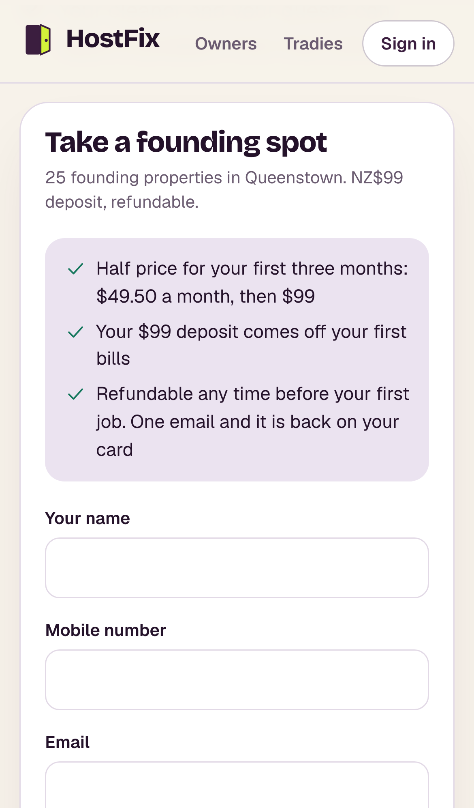
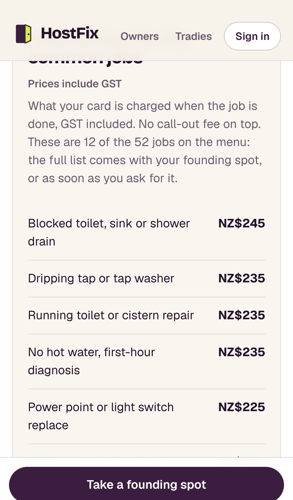
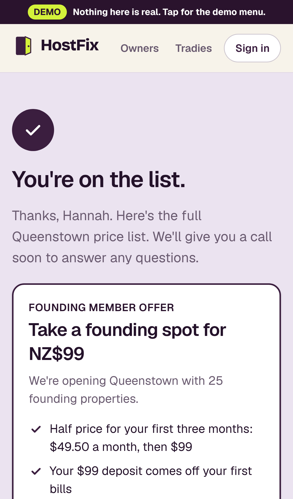
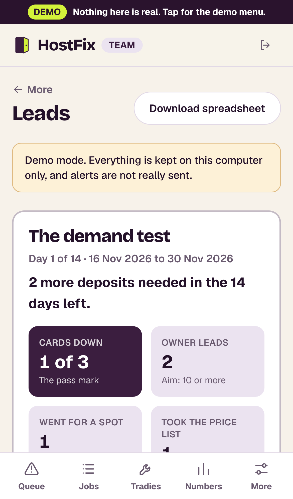

# The demand test

Fourteen days of ads to one owner page in Queenstown. It answers one question before anything else is
built or anyone is hired: **will holiday home owners pay?**

**The pass mark, agreed before the test: three owners put a card down for a founding spot.** A lead is
not demand. A card on file is.

Everything below is what you do. The site, the page, the deposit, the price list email and the scorecard
are built and tested.

---

## What an owner sees

1. **The owner page** (`/owners`): the problem, how it works, the real prices for the common jobs, the one
   membership (NZ$99 a month per property), the guarantee and the questions. The form has two buttons:
   - **Take a founding spot · NZ$99 deposit** goes straight to Stripe's card page.
   - **Not yet: just send me the price list** saves their details and shows the full price list.

   The ratio between those two buttons is the finding.
2. **The thank-you page** shows all 52 jobs at their fixed price, what else can be charged (urgent,
   after-hours, off-menu, parts), and the founding spot again for anyone who did not take it.
3. **The price list email** sends the same list, with a button back to the founding spot. It needs Resend
   with your own domain (below). Without it the owner still sees the list on the page.
4. **After paying**: a confirmation page, Stripe's receipt by email, and you get an alert.

| The form | The prices | After the form | Your scorecard |
| --- | --- | --- | --- |
|  |  |  |  |

The founding offer, as shown everywhere (change it on **More > Markets > Queenstown**):

- 25 founding properties. When they are gone the page stops taking cards by itself.
- NZ$99 deposit, refundable any time before their first job.
- Half price for the first three months: NZ$49.50 a month, then NZ$99.
- The deposit comes off their first bills.

> **Billing does not give the half price yet.** It takes the deposit off the first month, then charges full
> price. Nobody is billed during the test, so the test is not affected, but it must be built (or the
> promise changed) before Queenstown goes live. The go-live checklist shows this until it is done.

---

## Before you spend a dollar on ads

Do these in `SETUP.md` order. Times are rough.

| | What | Why it matters for the test |
| --- | --- | --- |
| 1 | **Steps 0 to 3**: the code on the branch, Supabase, Vercel, check it works (30 min) | The site has to be online, under your accounts |
| 2 | **`config/brand.ts`**: your contact email and company name (5 min) | The only two `[EDIT]` gaps left. They appear in the footer and the legal pages |
| 3 | **Step 6, Stripe**, the founding deposit part: secret key and webhook (20 min). Start in test mode, pay with `4242 4242 4242 4242`, check the lead shows **Paid NZ$99**, then refund it in Stripe and check it shows **Refunded**. Then switch to live keys | No card page, no test. The webhook is what marks a deposit paid or refunded if the owner closes the page early |
| 4 | **Step 4, Resend**, with your own domain verified and `EMAIL_FROM` on it (15 min plus DNS) | Lead alerts to you, and the price list email to owners. Resend's test sender can only email you |
| 5 | **`ALERT_EMAIL_TO`** (and `ALERT_SMS_TO` if texts are set up) | You hear about every lead within a minute, so you can ring them while they are still thinking about it |
| 6 | **Step 7, Meta Pixel and Conversions API** (15 min) | Meta learns who converts. Events: **Lead** (form sent), **InitiateCheckout** (founding spot pressed), **Purchase** (deposit paid) |
| 7 | **Step 8, your own domain** (10 min) | Ads to a vercel.app address look like a scam |
| 8 | **A lawyer, or at least a privacy statement and the deposit terms in plain words** | You are taking money from the public. The terms, privacy and deposit pages are placeholders today (`docs/LEGAL-TODO.md`). This is the one item on this list that is a real risk to skip |

Then, on the live site:

- Open `/owners` on your phone. Read every line as an owner would. Check the prices.
- Send the form with **Not yet: just send me the price list**. Check the email arrives and the link in it
  works on another device.
- Put down a real NZ$99 deposit with your own card, then refund it in Stripe. You have now tested the
  exact path an owner takes, and the refund promise.
- Open **Leads** (`/admin/leads`). Your test leads are there, with which button you pressed.

---

## The ads

### The links

Every ad points at the owner page with tags, so the scorecard can say which ad brought each owner. The
last tag, `utm_content`, is the name of the ad: keep it short and different for each ad.

```
https://YOUR-DOMAIN/owners?utm_source=facebook&utm_medium=paid&utm_campaign=qt-demand&utm_content=ad-a
https://YOUR-DOMAIN/owners?utm_source=facebook&utm_medium=paid&utm_campaign=qt-demand&utm_content=ad-b
https://YOUR-DOMAIN/owners?utm_source=google&utm_medium=cpc&utm_campaign=qt-demand-search&utm_content=search
```

Google Ads adds its own click id (`gclid`) by itself when auto-tagging is on, and the site keeps it too.

### Meta: one campaign, one ad set, two ads

- **Budget:** NZ$40 a day for 14 days, NZ$560. At NZ$20 a day Meta never gets enough results to learn, so
  you buy a direction, not a decision. Do not split the budget across two ad sets.
- **Who:** New Zealand and Australia, aged 35 to 65, interests in short-term rental hosting (Airbnb,
  holiday homes) and property investment. Not "Queenstown plus 40 km": most Queenstown holiday homes are
  owned by people who live in Auckland, Christchurch or Australia, which is exactly why they cannot get a
  tradie.
- **Optimise for** landing page views or leads. There will be too few deposits for Meta to optimise on
  them. Read the deposits on the scorecard instead.
- **Two ads in the one ad set**, vertical phone video, you talking, captions burned in. Shoot both in one
  session. Do not polish: a slick ad from an unknown brand reads as a scam; a local talking to camera
  reads as a local operator.

**Ad A, the cleaner's text** (about 35 seconds):

> *(holding up phone)* "If you own a holiday home in Queenstown, you've had this text. 'Hey, the shower's
> leaking.' And now you're ringing round tradies from another city while a guest checks in at three.
> So we're building a roster of vetted local tradies for holiday homes only. A tradie on site within 24
> hours, or within 4 hours when it's urgent. Fixed prices you see before you book. Miss the time and
> your month is free. Twenty-five founding properties in Queenstown, half price for three months.
> The link's below, with every price."

**Ad B, the roster** (about 35 seconds):

> "When something breaks at your Queenstown place you've got two options. Ring round three tradies and
> hope someone picks up. Or have a roster already lined up for holiday homes: a plumber, a sparky and
> handymen. Fixed prices before you book. On site within 24 hours, or 4 hours when it's urgent, or
> your month is free. We're not a bloke with a van, we're the roster behind him. Twenty-five founding
> properties, half price for three months. The link's below."

**What the ads must not say**, because the page does not and the product does not do it yet: an app or a
login, "one number to ring", "on site in 4 hours" without saying urgent costs NZ$50 more, any statistic
you cannot source (the "three in four problems" figure is unsourced), what an owner's property earns,
or that the tradies are already signed. Everything an ad promises has to be on the page they land on.

### Google Search: small, high intent, your home turf

- **Budget:** NZ$15 to NZ$20 a day. Volume will be tens of searches a month, but each one is someone
  with the problem right now.
- **Keywords** (phrase and exact): holiday home maintenance queenstown, airbnb maintenance queenstown,
  property maintenance queenstown, handyman queenstown, plumber queenstown, electrician queenstown,
  holiday home manager queenstown.
- **Negatives:** jobs, job, apprentice, salary, course, training, diy, how to, wanaka (until Wānaka is
  served).
- **Ad copy:** fixed prices (the drain is NZ$245, the tap NZ$235), 24-hour or 4-hour response, month free
  if missed, 25 founding spots. Point the final URL at the Google link above.

### Tradies

Do not advertise to tradies during the test. If three owners put a card down, ring the tradies with real
jobs to offer instead of a promise. The scorecard counts any tradie who signs up on `/tradies` anyway,
against the target of two handymen, a plumber and an electrician.

---

## Running it

**Day 1, the day the ads go live:** open **Leads** and press **Start the 14 days today**. The scorecard
counts everything from that moment.

**Every day (15 minutes):**

1. Open **Leads**. The scorecard at the top shows the day, cards down against the pass mark, how many
   owners went for a spot or took the price list, and which ad each came from.
2. **Ring every new owner the same day.** One question matters more than the rest: *"What happened the
   last time something broke with a guest in the house?"* If the story is painful, you have a buyer: ask
   for the founding spot. If there is no story, thank them and move on. Write down what they say.
3. Check the ad accounts for spend and cost per landing page view. The site does not see spend.

**Day 7:** if the page is getting visits but nobody presses either button, the page is the problem. If it
is getting no visits, the ad is. Change one thing, not both. If one ad has all the clicks, turn the other
off.

**If the card page fails or an owner wants their money back:** refund it in Stripe (**Payments**, the
payment, **Refund**). The site marks it refunded by itself, and the spot opens up again.

---

## Reading the result on day 14

The scorecard gives the verdict in one line. What to do with it:

| What happened | What it means | Next |
| --- | --- | --- |
| **3 or more cards down** | Owners will pay. | Ring the tradies with real work. Build the founding billing (half price for three months). Open Queenstown. |
| **1 or 2 cards down, good calls** | Interest, not yet proof. | Run another 14 days on the ad that brought the cards. Do not build anything yet. |
| **Plenty took the price list, nobody paid** | The prices interest them; the membership does not. | That is the answer, for NZ$560 instead of six months. Test a different offer before building more: no membership, pay per job. |
| **Few visits at all** | The ads did not reach owners. Nothing learned about the offer yet. | Fix the targeting or the creative and run again before drawing any conclusion. |

Judge on three things together: cost per landing page view (did the ad earn the click), the share of
owners who pressed the founding spot button (did the page convert), and what the first ten owners said
on the phone. At NZ$560 the numbers will not be statistically certain. The calls will tell you more.

---

## Where things live

| What | Where |
| --- | --- |
| The scorecard, the leads and which button each pressed | `/admin/leads` (download as a spreadsheet there) |
| The founding offer: deposit, spots, promises | More > Markets > Queenstown, "Referrals and the founding deposit" |
| The prices | More > Markets > Queenstown, the menu (changes apply to new jobs and the price list at once) |
| The page wording | `content/landing-owner.md` |
| The go-live checklist | `/admin/setup` |
| Why each decision was made | `DECISIONS.md` |
