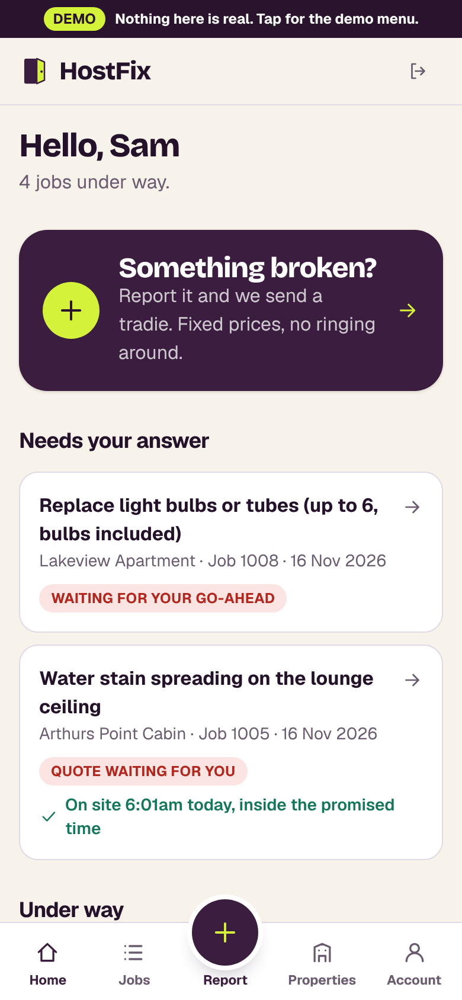
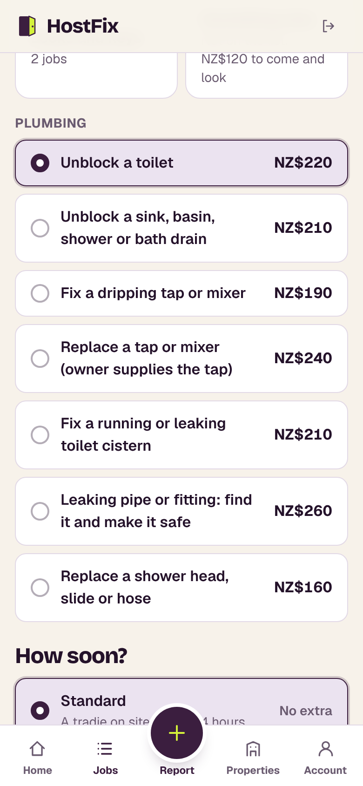
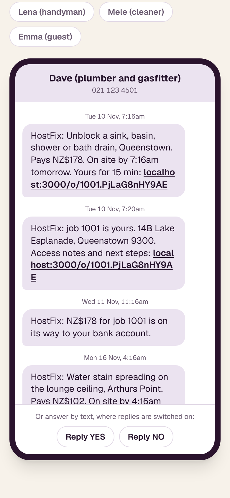
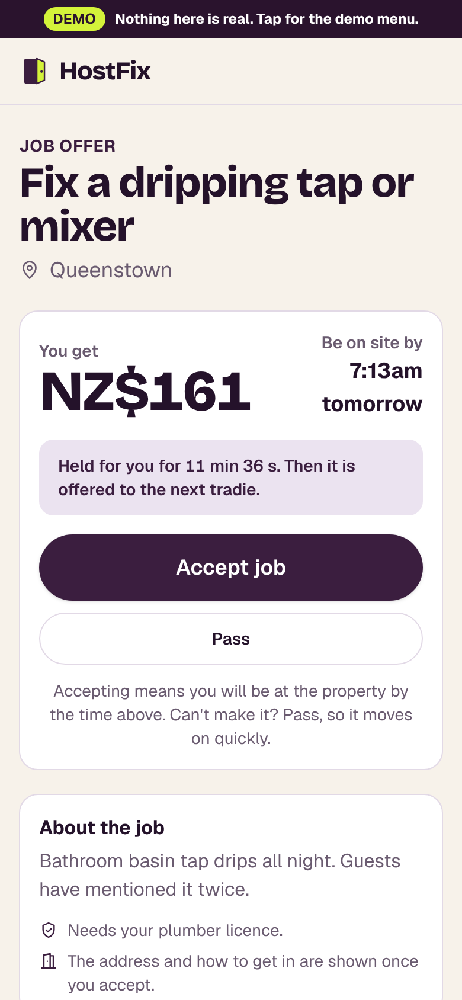
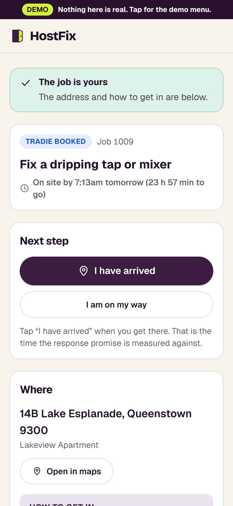
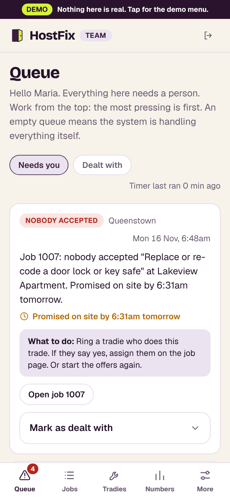
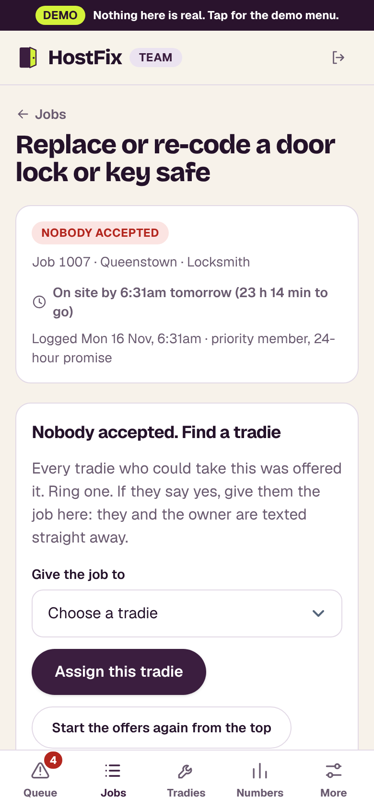
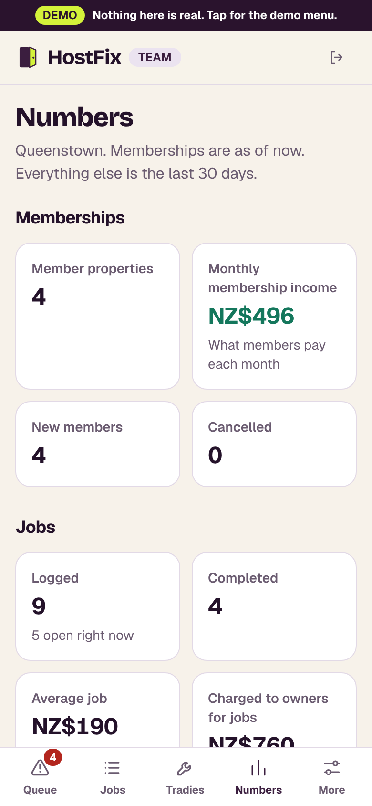

# Try it: what to click, phase by phase

Everything here runs in **demo mode**: the real product, with a made-up Queenstown business inside it.
Three owners, five tradies, a dispatcher and nine jobs at different points. No accounts to set up. No
real texts are sent and no real money moves, so press everything.

## Opening the demo

On a computer with Node.js 22 or newer, in the `hostfix` folder:

```bash
npm install
```

```bash
npm run demo
```

Then open `http://localhost:3000/demo`. Make the browser window narrow, or open it on your phone: it is
built for a phone first.

The page that opens is the **demo menu**. It does three things the real site cannot:

- **Be someone.** Sign in as any sample person with one tap.
- **Open someone's phone.** Read the texts each person was sent. The links in them work.
- **Skip ahead in time.** Jump 15 minutes, an hour, four hours or a day, to watch an offer move on or a
  payment go out.

To start again from scratch: stop it, delete the `.data` folder, start it again.

## The ten-minute tour

Do this first. It touches every side once.

1. **Open Dave the plumber's phone.** The newest text is a job offer: what it is, the suburb, what it
   pays, and a link. Tap the link. You are not signed in, and you do not need to be.
2. You see the pay and the suburb, but **not the address or the lockbox code**. Press **Accept job**.
   Now both appear.
3. Press **I have arrived**. Try **Job done** without a photo: it refuses. Add a photo, write a line,
   press **Job done**. It tells Dave when his payment will be sent.
4. **Open Sam the owner's phone.** He was texted when Dave was booked, when he arrived, and when it was
   done, with the amount charged to his card. He did nothing.
5. **Be Sam Taylor.** His home screen shows two things that need his answer: a quote from a plumber who
   is on site at his cabin, and a guest's report from his apartment. Answer both.
6. Press **Report** (the round button) and log a new problem. Note the price shown before you press
   **Send a tradie**.
7. **Be Maria (dispatcher).** Her queue holds only what the system could not sort out. Open the one that
   says nobody accepted, pick a tradie, press **Assign this tradie**. It leaves the queue by itself.
8. Back on the demo menu, **Skip 1 day**. Then be **Admin (you)** and open **Numbers**. Under **Jobs**
   press **Done** and open the tap job: the owner's card was charged and Dave's payment has been sent.
   Anything you left unanswered for a day has been dealt with too: a guest report nobody approved is
   cancelled, and a job nobody reached in time has credited the owner's month.

## What it looks like

Taken from the demo on a phone-sized screen. The full-size pictures are in `docs/screens/`.

| The owner | Reporting a problem | The tradie's text | The offer |
| --- | --- | --- | --- |
|  |  |  |  |

| After accepting | The dispatcher's queue | A job nobody took | The numbers |
| --- | --- | --- | --- |
|  |  |  |  |

Also in that folder: the two public pages, the QR card, an owner's monthly statement, a tradie's pay
statement, the tradies page, the menu editor and the demo menu.

---

The lists below start from the sample business as it first opens. If you have already answered
something on the tour, delete the `.data` folder and start again to get it back.

## Phase 1: owner and property

| Do this | You should see |
| --- | --- |
| Demo menu > **The public site** > **I own a holiday home** > **Join in Queenstown**. Make up a name, email and mobile. The six-digit code is shown on screen in the demo (on the real site it is emailed). | A new owner account, with no password |
| Add a property: a name, the address, how a tradie gets in. The one membership, **Essential**, is already chosen. **Save and continue**. | The property, not yet covered |
| Press **Report** before paying | "Start a membership first" |
| **Continue to payment**, then pay on the pretend card page | "You are covered", and the plan and price |
| On the property page: **Print the QR card** | A card to print and leave in the property, with the guest link under it |
| On the property page, under **For your cleaner or co-host**: **Send to my cleaner** or **Copy the link** | The link to send your cleaner. A report from it sends a tradie straight away. |
| Open **Address, access notes and guest reports** | Whether a guest's report needs your yes first, and your own spending limit for quotes |
| Open **Photos for tradies** and add one | Photos only the tradie who takes a job there will see |
| **Account > Billing** (as Sam, who has history) | The card on file with **Change card**, and a statement for each month with **Print or save**: jobs, memberships, credits and the GST inside the total |
| On Sam's property page: **Change plan**, then **Cancel membership** | The plan changes with no part-month charge. Cancelling takes effect at the end of the paid month. |

**Not done in Phase 1:** real card payments need your Stripe account (`SETUP.md` step 6). Owners cannot
delete their own account.

## Phase 2: jobs and dispatch

| Do this | You should see |
| --- | --- |
| Demo menu > **Scan the QR card as a guest**. Choose Plumbing, pick a job, give a name, **Report it**. | No prices anywhere. "Your host has been told." Nobody is sent. |
| Open **Sam's phone** | A text asking whether to send someone |
| Demo menu > **Report as the cleaner**. Pick a job, **Report it**. | A tradie is being found at once. Sam is texted the price. |
| As Sam: **Report** at Arthurs Point Cabin, choose a job, choose **Get someone there within 4 hours** | NZ$50 more, and the tradie drops what they are doing. Before 7am, after 4:30pm or at the weekend it is NZ$140 more on top. The tradie's offer shows their share: the surcharges less 15% (NZ$42.50 and NZ$119). |
| As Sam: **Report**, choose **Something else** | NZ$225 for a tradie to come and look, with a quote to follow |
| Log a plumbing job as Sam. Demo menu > **Skip 15 minutes**. As Maria, open it from **Jobs**. | "Who was offered it": the first choice ran out, the backup is being asked now |
| **Skip 15 minutes** again | The backup ran out too. The sample has no third plumber, so it is in Maria's queue as "Nobody accepted", and Sam has been texted that the team is on it. |
| **Be Mere (plumber)**. Open her job. | She is on site with a quote of NZ$685 waiting. It is over NZ$600, so she cannot start until the owner says yes. |
| As a tradie who has arrived at a job: **Could not get in?** | The tradie is paid the call-out and the owner is charged it. A photo is needed as proof. |
| **Be Dave**, open **Profile** | His licences and their end dates. **Taking a break?** pauses offers. |
| As Admin: Tradies > open a tradie > change a licence's "Runs out on" date to last month > **Save licence** | The licence shows "Run out", and the page says they are no longer offered that work. Their other work is unaffected. |

**Not done in Phase 2:** real texts need ClickSend or Twilio, and New Zealand numbers need a 4 to 6 week
registration first (`SETUP.md` step 5). Replying YES to a text is built but switched off per market, and
ClickSend's side of it has not been proven with a real reply. Tradies are not sent push notifications.
The owner's real phone number is visible to the tradie once they accept.

## Phase 3: money

| Do this | You should see |
| --- | --- |
| As Admin: **Jobs** > any finished job > **Money** | What the owner paid, what the tradie gets, what you keep, line by line |
| **Be Priya Patel** (her card is declining) | Her home screen and the job itself say the card could not be charged. As Maria: it is in the queue as "Card payment failed". As Tom, under **Pay**: that job is waiting on the owner's card. |
| As Maria on that job: **Try the card again now** | In the demo her card still declines. On the real site this charges the new card. |
| As Maria, open **Owner raised a problem** in the queue | Sam has already said the new silicone is lifting. The tradie's payment is on hold. |
| On that job: **Refund the owner**, half the amount, a note, **Settle it** | The owner is refunded, and the tradie's payment and your fee come down in proportion |
| As Sam, open any other finished job: **Something not right with this job?** | How an owner raises one. It lands in Maria's queue. |
| As Admin: **More > Owners > Sam Taylor** | A credit for a missed promise, given automatically. One of the sample jobs missed its time. |
| Finish a job as a tradie, then **Skip 1 day** | "Was sent", and a text to the tradie |
| **Be Tom (electrician)** > **Pay** | A month-by-month statement of what he was paid |
| **A tradie who has not been approved yet:** sign out, open `/sign-in`, enter `021 123 4506`, use the code shown, then **Profile** > **Add bank details** | The pretend version of Stripe's page, then "Bank details set up. You can be paid." Her home still says her details are being checked. |
| As Admin: More > Markets, prices and the menu > Queenstown > untick "The business is registered for GST" and save | The sample business is marked as registered, so statements show GST. Unticked, they show none. That is how the real site starts. |

**Not done in Phase 3:**

- **"Pay the tradie within 48 hours" is not possible as money in the bank.** The payment is sent after 24
  hours. Stripe then holds New Zealand card money for 4 working days, so it lands about 5 to 6 working days
  after the job. The pages say so honestly. There is a way to get it down to 2 or 3 days once you have
  income in Stripe (`docs/PLAN.md`, section 9, item A).
- **None of the real Stripe calls for memberships, job payments or paying tradies have been run against a
  real Stripe account.** They are tested against a stand-in. `docs/STRIPE-TEST-CHECKLIST.md` runs each one
  in Stripe's test area. Do it before any real payment.
- **GST:** the app shows GST once you tick the box, but who the seller is and what a tax invoice must show
  are your accountant's call. Statements are pages with a **Print or save** button, not emailed PDFs.
- **The tradie is only paid once the owner's card goes through.** If you would rather pay the tradie
  regardless and carry that risk yourself, say so.
- Referral rewards are tracked and queued, then paid by you by bank transfer.

## Phase 4: running it

| Do this | You should see |
| --- | --- |
| **Be Maria**. Read the **Queue**. | Only exceptions, most pressing first, each with "What to do" |
| Press **Mark as dealt with** on one, with a note | It moves to **Dealt with**, with her name |
| As Maria, press **Numbers**, then try **More** | Numbers are for admins. She has Owners, and Texts and emails. No prices, markets, staff or leads. |
| **Be Admin**. **Numbers**. | Member properties, monthly membership income, new and cancelled, jobs, average job, what you kept, time to accept, time on site, promises missed, credits |
| **Tradies** | Per trade: first choice, backup, and how many are ready today. Each tradie's accepted and on-time figures for 30 days. |
| Under a trade: **Change who gets first pick** | First choice and backup, changed in one step |
| More > **Markets, prices and the menu** > Queenstown > open a job on the menu | Owner pays, tradie gets, what you keep and the percentage. Change it and **Save job**: it applies to the next job logged. |
| On the same page: **Add a membership** | A new plan, offered the next time an owner adds a property. (The public page's words about plans are in `content/landing-owner.md`.) |
| Markets > **Add a market**: name Wanaka, short code `wanaka`, New Zealand | A hidden draft with the menu copied. Set **Stage** to "Waiting list" and open `/in/wanaka`. |
| More > **Staff** > **Add someone** | A dispatcher who signs in with their own email |
| More > **Audit log** | Every job change and money movement, with who did it. Nothing can be edited. |
| More > **Texts and emails** | Everything the system sent, and anything that failed |
| More > **Setup checklist** | Which outside accounts are connected. In the demo, most say "To do". |

**Not done in Phase 4:** existing members cannot be moved to a new price in bulk. Deleting a person's
details on request needs a developer. Nothing warns you before a tradie's insurance runs out.

## Phase 5: planned, not built

Seasonal packages, the quarterly property check, cleaner accounts, slot fees and connections to property
management software. `docs/PLAN.md`, section 9, has each one, what is already in place, and the order I
would build them in.

---

## What is needed from you before a real owner can join

In order. `SETUP.md` has the steps.

1. **Start the ClickSend New Zealand registration today.** It takes 4 to 6 weeks and nothing works for a
   Queenstown tradie without it.
2. **A lawyer** for the four legal pages, and **an accountant** for GST (`docs/LEGAL-TODO.md`).
3. **The accounts:** Supabase, Vercel Pro, Resend with your domain, Stripe.
4. **Real prices.** Every price on the menu is a placeholder. Set them with your first plumber and handyman.
5. **Tradies.** At least two ready in every trade on the menu.
6. **The Stripe test checklist**, then one real job with people you know.
7. **The words.** Replace the `[EDIT: ...]` placeholders on the two public pages.

## Things I changed, or would push back on

- **Accept by link, not by reply.** New Zealand phone companies do not let a business receive replies
  without a registered short code. One tap on a link is faster anyway. Reply YES is there for later.
- **One credit per property per month.** Without a cap, one bad weekend costs a month's income on every
  property affected.
- **The link in a text never accepts by itself.** Phones and messaging apps open links to preview them.
  The tradie has to press **Accept job**.
- **A guest cannot send a tradie at your owner's cost.** Their report waits for the owner's yes, unless
  the owner switches that off.
- **A membership's price cannot be changed while members are on it.** Otherwise they are shown one price
  and charged another.
- **Urgent is always paid for, and never discounted to the tradie** (`DECISIONS.md`). If a membership that
  includes urgent call-outs ever comes back, the tradie still gets their share of the surcharge (less 15%) and you pay it.
- **Do not switch on slot fees yet** (`docs/PLAN.md`, section 9, item 5).
- **The membership price is five to ten times what comparable software charges** (`docs/MARKET-RESEARCH.md`).
  Sell the guarantee, not the app.
